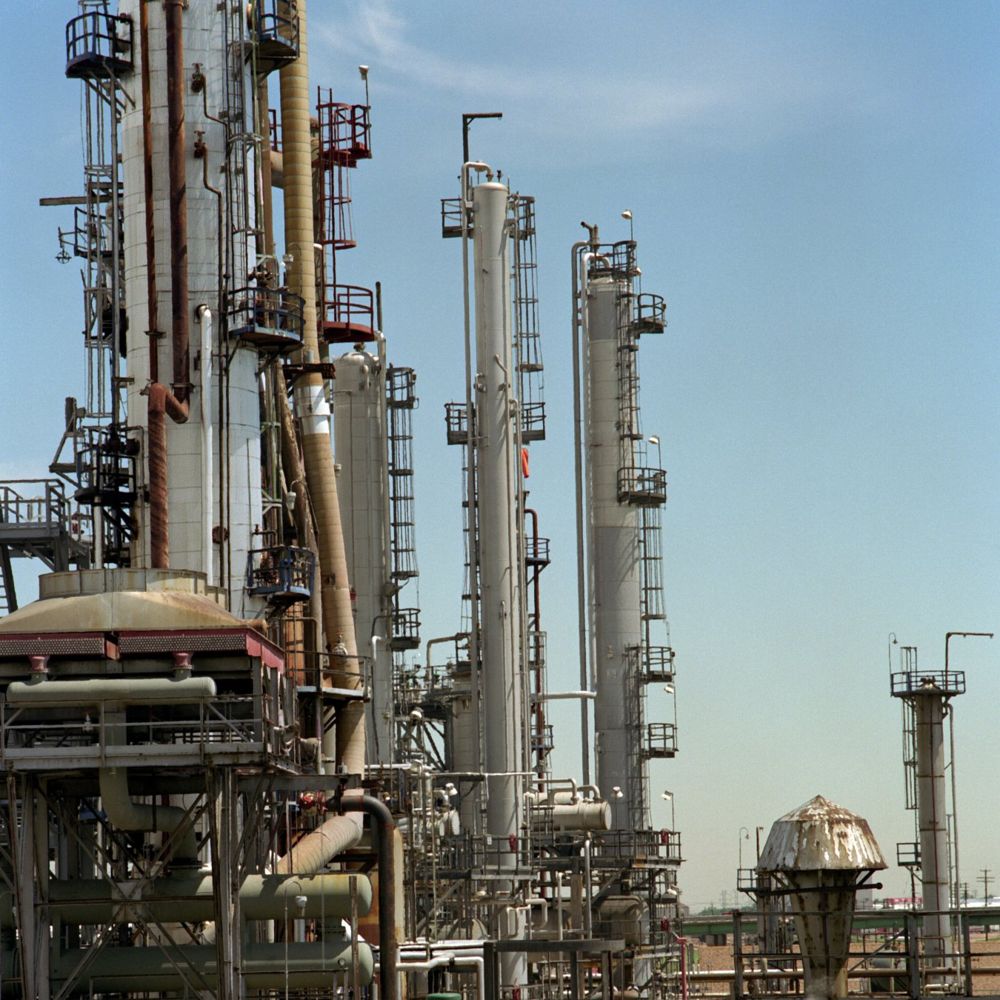
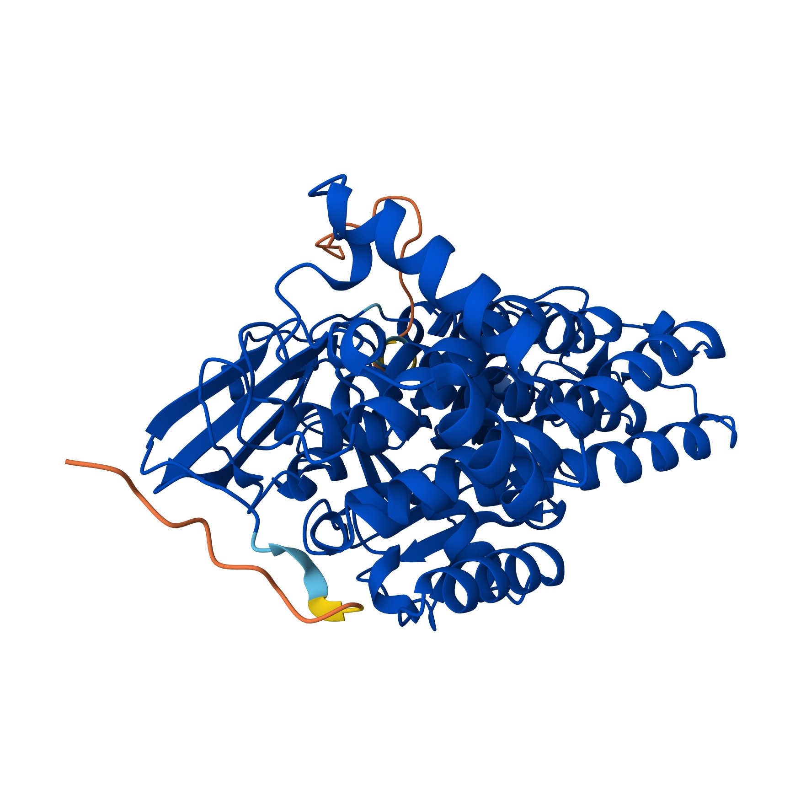

---
jupytext:
  formats: md:myst
  text_representation:
    extension: .md
    format_name: myst
    format_version: 0.13
    jupytext_version: 1.11.5
kernelspec:
  display_name: Python 3
  language: python
  name: python3
numbering:
  enumerator: 1.1.%s
---

# 1.1. Course Introduction

See also: [Course-wide Conventions & Notation](../notation.md)

Run the code: [Notebook for Section 1.1](https://wexlergroup.github.io/chem-4020-5020/lite/notebooks/index.html?path=chapter-01/section-01.ipynb), in which you can change and rerun the Python cells of this section in your browser.

The course map shows where this module sits in the course and which relations connect the microscopic and macroscopic descriptions. Select a module to unfold its sections.

<iframe
  src="https://wexlergroup.github.io/chem-4020-5020/computational-studios/course-map.html?module=1&amp;here=1.1"
  title="Course map, opened at Module 1"
  style="width: 100%; height: 830px; border: 0;"
  loading="lazy"
></iframe>

```{image} ../_static/course-map/module-1.png
:class: hidden
:alt: Course map with Module 1 unfolded. Statistical mechanics (Module 2) forms the microscopic strand, and Modules 1 and 3 to 7 form the macroscopic strand. A relation joins the two strands at each module except Module 6, and for Module 1 it is the kinetic theory of gases. Below the map, one card for each of Sections 1.1 to 1.4 lists the microscopic content, the connecting relations, and the macroscopic content of the section.
```

## Overview and Learning Objectives

Thermodynamics and statistical mechanics connect microscopic models of matter to macroscopic observables such as temperature, pressure, and free energy. This section introduces course conventions, the language of systems and surroundings, and the role of state variables in equilibrium descriptions. It also reviews common forms of energy, energy transfer, and the unit conventions used throughout the course.

This course develops the core concepts of thermodynamics and statistical mechanics and applies them to chemical systems. It builds on the thermodynamic principles introduced in [Chem 106](https://chemistry.wustl.edu/chemistry-105-106) and [Chem 112](https://chemistry.wustl.edu/chemistry-111-112), and on the quantum mechanics developed in [Chem 105](https://chemistry.wustl.edu/chemistry-105-106), [Chem 111](https://chemistry.wustl.edu/chemistry-111-112), and [Chem 401](https://chemistry.wustl.edu/physical-chemistry-i). By connecting molecular-level behavior to macroscopic thermodynamic observations, you will see how theory underpins real-world chemical processes.

---

Learning objectives:

- Define **system**, **surroundings**, and **boundary**; distinguish isolated/closed/open systems.
- Distinguish **state variables**/**state functions** from **process-dependent** (path) quantities, and explain what makes a quantity a **state function**.
- State the criteria for mechanical/thermal/chemical equilibrium used to justify thermodynamic state descriptions.
- Convert between common thermodynamic units (Pa, bar, atm; J, kJ, eV; K and °C) and check dimensional consistency.

## Core Ideas and Derivations

### Why Study Thermodynamics and Statistical Mechanics?

#### Bridging the Microscopic and Macroscopic Worlds

Typical chemical systems contain on the order of [Avogadro's number](https://physics.nist.gov/cgi-bin/cuu/Value?na) of particles (i.e., $N_{\mathrm{A}} = 6.022 \times 10^{23}$). Thermodynamics abstracts this complexity into a framework for predicting, among other things,

- reaction spontaneity,
- equilibrium states, and
- phase transitions.

#### Modern Applications

Thermodynamics and statistical mechanics are central to diverse fields, including industrial chemistry, materials science, and biochemistry. The examples below illustrate a few representative applications:

- **Industrial chemistry.** Predicting reaction spontaneity and modeling large-scale chemical processes.
- **Materials chemistry.** Designing advanced materials for optical, electronic, or mechanical applications.
- **Biochemistry.** Investigating protein folding and enzyme activity in biological systems.

:::::{figure}
:label: fig:applications

::::{grid} 3




::::

Three applications. From left to right: hydrogen production by steam–methane reforming ([U.S. Department of Energy](https://www.energy.gov/eere/fuelcells/hydrogen-production-natural-gas-reforming)), electricity generation with solar panels ([U.S. Department of Energy](https://www.energy.gov/eere/solar/cadmium-telluride)), and a protein structure predicted with AlphaFold ([AlphaFold Protein Structure Database](https://alphafold.ebi.ac.uk/entry/P21852)).
:::::

---

### Key Definitions

#### Thermodynamic Systems

```{code-cell} ipython3
:label: fig:systems
:caption: Types of thermodynamic systems. (a) An isolated system exchanges neither energy nor matter with its surroundings. (b) A closed system exchanges energy but not matter. (c) An open system exchanges both energy and matter.
:tags: [hide-input]

import sys

import matplotlib.pyplot as plt
from matplotlib.patches import FancyBboxPatch

sys.path.append("..")            # the book folder, which holds figstyle
import figstyle as fs


def draw_system(ax, c, energy=False, matter=False):
    """Sketch of a system in its surroundings, with the exchanges that its boundary allows."""
    ax.add_patch(FancyBboxPatch((0.32, 0.30), 0.36, 0.36, boxstyle="round,pad=0.03,rounding_size=0.06",
                                fc=c.fill, ec=c.ink, lw=1.6))
    ax.text(0.5, 0.56, "System", ha="center", va="center")
    ax.text(0.5, 0.06, "Surroundings", ha="center", va="center", color=c.muted)
    ax.annotate("Boundary", xy=(0.60, 0.69), xytext=(0.80, 0.90), ha="center", va="center", color=c.muted,
                arrowprops=dict(arrowstyle="-", color=c.muted, lw=0.8, shrinkA=2, shrinkB=1))
    if energy:
        ax.annotate("", xy=(0.04, 0.40), xytext=(0.42, 0.40),
                    arrowprops=dict(arrowstyle="<|-|>", color=c.vermilion, lw=1.6, mutation_scale=12))
        ax.text(0.14, 0.45, "Energy", ha="center", va="bottom", color=c.vermilion)
    if matter:
        ax.annotate("", xy=(0.58, 0.40), xytext=(0.96, 0.40),
                    arrowprops=dict(arrowstyle="<|-|>", color=c.blue, lw=1.6, mutation_scale=12))
        ax.text(0.86, 0.45, "Matter", ha="center", va="bottom", color=c.blue)
    ax.set(xlim=(0, 1), ylim=(0, 1), aspect="equal")
    ax.axis("off")


def draw(c):
    fig, axes = plt.subplots(1, 3, figsize=(6.0, 2.3), constrained_layout=True)
    for ax, letter, title, exchange in zip(axes, "abc", ["Isolated system", "Closed system", "Open system"],
                                           [dict(), dict(energy=True), dict(energy=True, matter=True)]):
        draw_system(ax, c, **exchange)
        fs.panel(ax, letter, title)
    return fig


fs.show(draw, alt="Three sketches of a system, drawn as a box inside its surroundings. In panel a, nothing crosses "
                  "the boundary. In panel b, a two-headed arrow labeled energy crosses the boundary. In panel c, "
                  "two-headed arrows labeled energy and matter cross the boundary.")
```

```{glossary}
System
: The portion of the universe chosen for study, separated from its surroundings by a boundary.

Surroundings
: Everything external to the system that can exchange energy or matter with it.

Boundary
: The interface separating a system from its surroundings.

Isolated system
: Exchanges neither energy nor matter with its surroundings.

Closed system
: Exchanges energy but not matter with its surroundings.

Open system
: Exchanges both energy and matter with its surroundings.
```

#### State of a System

```{mermaid}
%%{init: {"flowchart": {"htmlLabels": false}, "theme": "neutral", "look": "handDrawn", "layout": "elk"}}%%
flowchart TB
  subgraph B["Microscopic"]
    direction TB
      B1["Classical"] ~~~ B2["Quantum"]
  end

  subgraph C["Macroscopic"]
    direction TB
      C1["Equilibrium"]
  end

  subgraph C1["Equilibrium"]
    direction TB
      C11["Thermodynamic"]
  end

  subgraph C11["Thermodynamic"]
    direction LR
      C111["State variables"] ~~~ C112["State functions"] & C113["Path functions"]
  end

  subgraph C111["State variables"]
    direction TB
      C1111["Extensive"] ~~~ C1112["Intensive"]
  end

  A["State of a system"] --> B & C
```

```{glossary}
Particle
: A microscopic entity such as an atom, molecule, or ion.

Microscopic state (classical)
: Positions and momenta of all particles in the system.

Microscopic state (quantum)
: The wavefunction describing the system's particles.

Equilibrium
: A condition in which macroscopic properties remain constant over time.

Thermodynamic equilibrium
: Simultaneous mechanical, thermal, and chemical equilibrium.

Thermodynamic state
: A set of macroscopic variables defining a system in equilibrium.

State variable
: A property that defines a system's state.

State function
: A property depending only on the system's state, not on the path taken.

Equation of state
: A mathematical relationship among state variables.

Path function
: A property depending on the process or path taken between states.

Process
: A transformation changing a system from one state to another.

Extensive property
: A property proportional to system size (e.g., volume, entropy).

Intensive property
: A property independent of system size (e.g., temperature, pressure).
```

A hiking analogy helps separate the two kinds of quantities. Between two trailheads, the change in elevation is fixed once the start and end points are chosen, whereas the distance walked depends on the trail taken. [Section 3.1](../chapter-03/section-01.md) puts this distinction to work for internal energy, heat, and work.

#### Describing an Equilibrium State

Not every state variable can be chosen freely. For a fixed amount $n$ of a pure, single-phase gas, specifying any two of $P$, $V$, and $T$ fixes the third through an equation of state, such as the ideal-gas law $PV=nRT$ derived in [Section 1.3](section-03.md). Constraints imposed by the boundary, such as walls that cannot move or walls that do not conduct heat, determine which variables are free to change during a process.

Each kind of equilibrium corresponds to an equality across a boundary that permits the relevant exchange:

- **Mechanical equilibrium:** no unbalanced forces; across a movable boundary, the pressure of the system equals that of its surroundings.
- **Thermal equilibrium:** across a boundary that conducts heat, the temperature of the system equals that of its surroundings.
- **Chemical equilibrium:** no net change in composition; across a boundary that passes matter, the chemical potential $\mu$ of each species is the same on both sides. The chemical potential is introduced in [Section 6.1](../chapter-06/section-01.md).

---

### Basic Forms of Energy and Energy Transfer

```{mermaid}
%%{init: {"flowchart": {"htmlLabels": false}, "theme": "neutral", "look": "handDrawn", "layout": "elk"}}%%
flowchart TB
  subgraph H1["Electrostatic"]
    direction TB
      H11["Charge–charge"] ~~~ H12["Charge–dipole"]
  end
  subgraph H2["van der Waals"]
    direction TB
      H21["Dipole–dipole"] ~~~ H22["Induced dipole"] ~~~ H23["Dispersion"]
  end
  subgraph H["Electric"]
    direction LR
      H1 ~~~ H2
  end
  subgraph I1["Intramolecular"]
    direction TB
      I11["Covalent"] ~~~ I12["Ionic"] ~~~ I13["Metallic"]
  end
  subgraph I2["Intermolecular"]
    direction TB
      I21["Hydrogen"] ~~~ I22["van der Waals"]
  end
  subgraph I["Chemical"]
    direction LR
      I1 ~~~ I2
  end
  subgraph J["Mechanical"]
    direction TB
      J1["Expansion"] ~~~ J2["Surface expansion"] ~~~ J3["Extension"]
  end
  subgraph G["Work"]
    direction LR
      J ~~~ G1["Electrical"]
  end

  A["Basic forms of energy and energy transfer"] --> B["Energy"] & C["Energy transfer"]
  B --> D["Kinetic"] & E["Potential"]
  C --> F["Heat"] & G
  E --> H & I
  H1 & H2
  I1 & I2

  style H11 stroke:red, stroke-width:2px
  style H2 stroke:blue, stroke-width:2px
  style I12 stroke:red, stroke-width:2px
  style I22 stroke:blue, stroke-width:2px
```

#### Energy

```{glossary}
Kinetic energy
: Energy due to motion (e.g., a moving particle).

Potential energy
: Energy due to position or configuration (e.g., a stretched spring).

Internal energy
: The total microscopic kinetic and potential energy of a system, averaged over its microstates.
```

#### Energy Transfer

```{glossary}
Work
: Energy transferred when a force acts over a distance (e.g., lifting a mass).

Heat
: Energy transferred because of a temperature difference (e.g., conduction from hot to cold).
```

---

### Important Units

#### SI Units[^4]

```{list-table} **Base SI Units**
:header-rows: 1
:name: physical-quantities-basic

* - Quantity
  - Unit
  - Symbol
* - Time
  - second
  - s
* - Length
  - meter
  - m
* - Mass
  - kilogram
  - kg
* - Temperature
  - kelvin
  - K
```

```{list-table} **Derived SI Units**
:header-rows: 1
:name: physical-quantities-units

* - Quantity
  - Unit
  - Symbol
  - Conversion
* - Frequency
  - hertz
  - Hz
  - $1 \,\text{Hz} = 1 \,\text{s}^{-1}$
* - Force
  - newton
  - N
  - $1 \,\text{N} = 1 \,\text{kg m s}^{-2}$
* - Pressure
  - pascal
  - Pa
  - $1 \,\text{Pa} = 1 \,\text{N m}^{-2}$
* - Energy
  - joule
  - J
  - $1 \,\text{J} = 1 \,\text{N m}$
```

[^4]: [https://www.nist.gov/pml/owm/metric-si/si-units](https://www.nist.gov/pml/owm/metric-si/si-units)

#### Non-SI Units[^5][^6][^7]

```{list-table} **Non-SI Units**
:header-rows: 1
:name: non-si-units-table

* - Quantity
  - Unit
  - Symbol
  - Conversion
* - Pressure
  - bar
  - bar
  - $1 \,\text{bar} = 1 \times 10^5 \,\text{Pa}$
* - Pressure
  - atmosphere
  - atm
  - $1 \,\text{atm} \approx 1.01325 \,\text{bar}$
* - Pressure
  - torr
  - torr
  - $1 \,\text{torr} = \frac{1}{760}\,\text{atm}$
* - Pressure
  - millimeters of mercury
  - mmHg
  - $1 \,\text{mmHg} = 1 \,\text{torr}$
* - Energy
  - electronvolt
  - eV
  - $1 \,\text{eV} = 1.602 \times 10^{-19} \,\text{J}$
* - Energy
  - calorie
  - cal
  - $1 \,\text{cal} = 4.184 \,\text{J}$
```

[^5]: [https://www.nist.gov/pml/sensor-science/thermodynamic-metrology/unit-conversions](https://www.nist.gov/pml/sensor-science/thermodynamic-metrology/unit-conversions)  
[^6]: [https://physics.nist.gov/cgi-bin/cuu/Value?evj](https://physics.nist.gov/cgi-bin/cuu/Value?evj)  
[^7]: [https://www.nist.gov/pml/special-publication-811/nist-guide-si-appendix-b-conversion-factors/nist-guide-si-appendix-b8#C](https://www.nist.gov/pml/special-publication-811/nist-guide-si-appendix-b-conversion-factors/nist-guide-si-appendix-b8#C)

#### Energy Scales

The energies in this course span many orders of magnitude, and they are quoted per mole (kJ/mol) or per molecule (eV, or cm$^{-1}$ in spectroscopy). [](#fig:energy-scales) places several of them on one logarithmic axis.

% Try this: Add an energy of your own to the list `energies`. For example, add the line `("photon of green light, 500 nm", h * c_light / 500e-9 * N_A / 1000),` above the line of the H–H bond. Which of the other energies is it closest to?

```{code-cell} ipython3
:label: fig:energy-scales
:caption: Energies that appear in this course on one logarithmic axis, in kJ/mol, with the equivalent energies per molecule in eV and in cm$^{-1}$. The thermal energy $k_{\mathrm{B}}T$ at room temperature (orange; per mole, $RT = 2.48\ \mathrm{kJ\,mol^{-1}}$) is the yardstick with which the other energies are compared throughout the course. The rotational and vibrational quanta of HI follow from the constants in [Section 7.2](../chapter-07/section-02.md), and the hydrogen-bond energy is the estimate of [Section 6.2](../chapter-06/section-02.md).
:tags: [hide-input]

import numpy as np
from scipy.constants import N_A, R, c as c_light, e, h

kJ_per_eV = e * N_A / 1000                     # 1 eV per molecule in kJ/mol
kJ_per_wavenumber = h * c_light * 100 * N_A / 1000   # 1 cm^-1 per molecule in kJ/mol

# Energies in kJ/mol, from small to large
energies = [
    ("rotation of HI, one quantum", 2 * 6.4264 * kJ_per_wavenumber),      # 2B, constants from Section 7.2
    (r"$k_{\mathrm{B}}T$ at 298 K", R * 298.15 / 1000),
    ("hydrogen bond in water", 20),                                       # estimate used in Section 6.2
    ("vibration of HI, one quantum", 2309.01 * kJ_per_wavenumber),        # constants from Section 7.2
    ("vaporization of water", 40.7),                                      # at 1 atm, NIST Chemistry WebBook
    ("H–H bond", 436),
    ("ionization of H", 13.598 * kJ_per_eV),
]


def draw_energy_scales(c):
    fig, ax = plt.subplots(figsize=(fs.WIDTH, 4.0))
    fig.subplots_adjust(left=0.035, right=0.965, top=0.99, bottom=0.44)
    top = len(energies)
    for row, (name, energy) in enumerate(energies):
        height = top - row
        thermal = "k_{\\mathrm{B}}T" in name
        color = c.vermilion if thermal else c.ink
        ax.plot([energy, energy], [0, height], color=c.vermilion if thermal else c.muted, lw=1.6 if thermal else 0.9)
        ax.plot(energy, 0, "o", color=color, ms=5, clip_on=False, zorder=5)
        value = f"{energy:.2f}" if energy < 10 else f"{energy:.0f}" if energy >= 100 or energy == 20 else f"{energy:.1f}"
        about = "about " if energy == 20 else ""
        ax.text(energy * 1.12, height, f"{name}, {about}{value} kJ/mol", color=color, va="center", ha="left")
    ax.set(xscale="log", xlim=(3e-2, 3e5), ylim=(0, top + 0.6), yticks=[])
    ax.spines["left"].set_visible(False)
    ax.set_xlabel("Energy per mole (kJ/mol)")
    for position, factor, label in [(-0.25, kJ_per_eV, "Energy per molecule (eV)"),
                                    (-0.50, kJ_per_wavenumber, r"Energy per molecule, as a wavenumber (cm$^{-1}$)")]:
        axis = ax.secondary_xaxis(position, functions=(lambda x, f=factor: x / f, lambda x, f=factor: x * f))
        axis.set_xlabel(label)
    return fig


fs.show(draw_energy_scales,
        alt="A logarithmic energy axis from 0.03 to 300,000 kilojoules per mole, with matching axes in electronvolts "
            "and in wavenumbers. Seven energies are marked. In increasing order: one rotational quantum of hydrogen "
            "iodide, 0.15; the thermal energy k B T at 298 K, 2.48; a hydrogen bond in water, about 20; one "
            "vibrational quantum of hydrogen iodide, 27.6; the vaporization of water, 40.7; the H–H bond, 436; and "
            "the ionization of the hydrogen atom, 1312 kilojoules per mole.")
```

## Worked Example

### Unit conversions you will use constantly

A gas sample has pressure $P=1.50\ \mathrm{atm}$ at $T=25.0^{\circ}\mathrm{C}$. Convert $P$ to bar and Pa, and convert $T$ to kelvin.

**Assumptions.** Use $1\ \mathrm{atm}=1.01325\times 10^{5}\ \mathrm{Pa}$ and $1\ \mathrm{bar}=10^{5}\ \mathrm{Pa}$.

1. **Temperature to kelvin**

   ```{math}
   T(\mathrm{K}) = T(^{\circ}\mathrm{C}) + 273.15
   \quad\Rightarrow\quad
   T = 25.0 + 273.15 = 298.15\ \mathrm{K}.
   ```

2. **Pressure to pascals**

   ```{math}
   P = (1.50\ \mathrm{atm})\left(1.01325\times 10^{5}\ \frac{\mathrm{Pa}}{\mathrm{atm}}\right)
   = 1.52\times 10^{5}\ \mathrm{Pa}.
   ```

3. **Pressure to bar**

   ```{math}
   P = \frac{1.52\times 10^{5}\ \mathrm{Pa}}{10^{5}\ \mathrm{Pa/bar}} = 1.52\ \mathrm{bar}.
   ```

4. **Units of the product $PV$**

   Dimensions can be checked for an expression as well as for a number. Using the derived SI units in {numref}`physical-quantities-units`,

   ```{math}
   [P][V] = \left(\mathrm{Pa}\right)\left(\mathrm{m^{3}}\right)
   = \left(\mathrm{N\,m^{-2}}\right)\left(\mathrm{m^{3}}\right)
   = \mathrm{N\,m} = \mathrm{J}.
   ```

**Result.** $T=298.15\ \mathrm{K}$, $P=1.52\times10^{5}\ \mathrm{Pa}=1.52\ \mathrm{bar}$, and $PV$ has units of energy.

## Concept Checks

1. Why does thermodynamics emphasize *state functions* rather than path-dependent quantities?
2. Give one real-world example each of an isolated, closed, and open system. What crosses the boundary in each case?
3. Which variables would you choose as “independent” to describe a gas in a rigid, sealed container? In a piston open to the atmosphere?
4. Why is dimensional analysis a useful error-checking tool in thermodynamic derivations?

## Key Takeaways

- Thermodynamics models macroscopic behavior using a small set of **state variables** together with equilibrium assumptions.
- Systems are classified by what they exchange across the boundary: **energy**, **matter**, or neither.
- **State functions** depend only on the state, not the path; unit consistency is non-negotiable.
- Clear notation and unit conventions reduce errors and make derivations reusable across topics.
